<div align="center">


# Portfólio RAIDENS

**Site oficial da equipe de robótica RAIDENS · SESI 192 Alumínio/SP**


### [Visitar o site →](https://sesiraidens.github.io/portifolio/)

[Sobre](#sobre) · [Identidade visual](#identidade-visual) · [Publicação](#publicação) · [Estrutura](#estrutura)

</div>

---

## Sobre

O portfólio é a vitrine da equipe RAIDENS: apresenta quem somos, os robôs e projetos que desenvolvemos, nossa participação em competições como a OBR e a MNR, e como entrar em contato.

O site é feito em **React** e publicado pelo **GitHub Pages**. Este repositório guarda a versão de produção já compilada, que é exatamente o que o Pages serve.

## Identidade visual

As versões oficiais da marca ficam em `assets/` e podem ser usadas nos outros projetos da equipe.

<table>
  <tr>
    <td align="center" width="33%"><br><sub><b>Colorida</b><br><code>logo_color</code></sub></td>
    <td align="center" width="33%"><br><sub><b>Monocromática</b><br><code>logo_mono</code></sub></td>
    <td align="center" width="33%"><br><sub><b>Com nome</b><br><code>logo_nome</code></sub></td>
  </tr>
</table>

Para usar a logo colorida em um README:

```html

```

## Publicação

O GitHub Pages publica o conteúdo do branch `gh-pages`. Para atualizar o site, gere a build do projeto React e substitua os arquivos deste branch pela nova versão. O `404.html` garante que links diretos para páginas internas continuem funcionando.

## Estrutura

```text
portifolio/
├── index.html      # Ponto de entrada da aplicação
├── 404.html        # Redirecionamento para rotas do React
├── assets/         # JS e CSS compilados, imagens, fontes e logos
├── favicon.ico
└── robots.txt
```

Os nomes dos arquivos em `assets/` levam um hash gerado na build (por exemplo `logo_color-aNRVU26Y.png`). Ao gerar uma nova build, os hashes podem mudar. Se isso acontecer, atualize os links para a logo nos outros repositórios.

---

<div align="center">


**Equipe RAIDENS** · SESI 192 Alumínio/SP

[](mailto:sesiraidens@gmail.com)
[](https://linktr.ee/sesiraidens)
[](https://github.com/sesiraidens)

</div>


